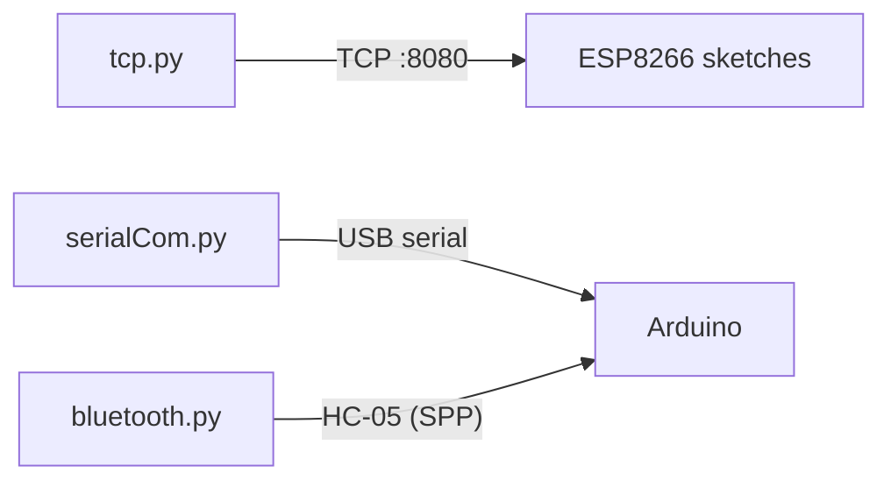

# ESP8266 Embedded Device Comms

> Arduino sketches and Python utilities for controlling ESP8266 relays over WiFi/TCP, plus serial and Bluetooth host-side tooling.

## Overview

This repository collects experiments in talking to embedded devices from a host
computer. The firmware (`.ino` sketches) targets the ESP8266 (NodeMCU) and runs
a small TCP server that drives relays, with optional debounced pushbutton input.
The Python utilities act as host-side clients, sending commands to the device
over TCP, USB serial, or an HC-05 Bluetooth serial bridge.

## Sketches (firmware)

| File | Description |
|------|-------------|
| `ard.ino` | ESP8266 WiFi TCP server (port 8080) controlling one relay. Client sends `0` to turn the relay OFF and `1` to turn it ON. |
| `tcp.ino` | Same single-relay TCP server as `ard.ino` (near-identical variant). |
| `bluetooth.ino` | Single-relay TCP server with commented-out scaffolding for a second relay. (Note: despite the filename, the sketch uses WiFi/TCP, not Bluetooth.) |
| `btnRebounceTCP.ino` | Two-relay TCP server with two debounced pushbuttons. Each button toggles its relay; relays can also be toggled over TCP (`1`/`2` toggle relay 1/2, `99` disconnects the client). |
| `btnRebounce.ino` | Standalone button-debounce demo: a debounced pushbutton toggles `LED_BUILTIN`. Prints press/release events over serial (based on a newbiely.com tutorial). |

## Utilities (host-side Python)

| File | Description |
|------|-------------|
| `tcp.py` | TCP client for the ESP8266 sketches. `--host` (default placeholder `192.168.x.x`), `--port` (default 8080). Sends typed numbers; `99` exits. |
| `serialCom.py` | USB serial client (`pyserial`). `--port` or `--index` (into the detected port list), `--baud` (default 9600), `--list` to print ports. Type `q` to quit. |
| `bluetooth.py` | HC-05 serial client. `--port` (default `/dev/cu.HC-05`), `--baud` (default 9600). Type `exit` to quit. |
| `common.py` | Shared argparse options and quit-word helper. |
| `restfulapi.py` | Empty placeholder (no implementation yet). |



## Hardware

- **Board:** ESP8266 NodeMCU (uses `ESP8266WiFi.h`)
- **Modules:** Relay module(s) on pins D1/D2 (GPIO5/GPIO4), pushbutton(s) on D5/D6, HC-05 Bluetooth-to-serial module (for `bluetooth.py`)
- Relays are wired active-LOW per the in-code comments.

## Tech stack

- **Firmware:** Arduino C/C++, ESP8266 core (`ESP8266WiFi`)
- **Host tools:** Python 3 (`socket` from the standard library, `pyserial`)
- **Protocols:** TCP sockets (port 8080), USB serial, Bluetooth SPP (HC-05)

## Setup / flashing

### Firmware (sketches)

1. Install the [Arduino IDE](https://www.arduino.cc/en/software) and add the
   ESP8266 board support package (Boards Manager URL:
   `http://arduino.esp8266.com/stable/package_esp8266com_index.json`).
2. Open the desired `.ino` sketch and select your ESP8266 NodeMCU board and port.
3. Update the `ssid` and `password` constants (and the relay/button pins if
   your wiring differs) before flashing — see **Limitations / next steps**.
4. Upload, then open the Serial Monitor (115200 baud for the WiFi sketches,
   9600 for `btnRebounce.ino`) to read the device's assigned IP address.

### Host utilities (Python)

```bash
python3 -m venv venv
source venv/bin/activate
pip install -r requirements.txt
```

```bash
python tcp.py --host <esp-ip> [--port 8080]
python serialCom.py --list            # show detected ports
python serialCom.py --port <device>   # or --index N
python bluetooth.py --port <device>
```

Tests for the pure logic (input validation, message framing, port selection):

```bash
pip install pytest && pytest
```

## Limitations / next steps

- The sketches hold placeholder WiFi credentials (`YOUR_WIFI_SSID` / `YOUR_WIFI_PASSWORD`);
  fill them in locally and do not commit real values.
- `ard.ino`, `tcp.ino`, and `bluetooth.ino` are near-duplicate single-relay
  servers and could be consolidated.
- `bluetooth.ino` is named for Bluetooth but actually implements a WiFi/TCP
  server; rename or repurpose for clarity.
- `restfulapi.py` is an empty stub.
- No authentication on the TCP server and no input validation beyond basic
  numeric parsing; not intended for untrusted networks.
- `serialCom.py` defaults to port index 4 when `--port` is not given; use `--list` to find yours.
